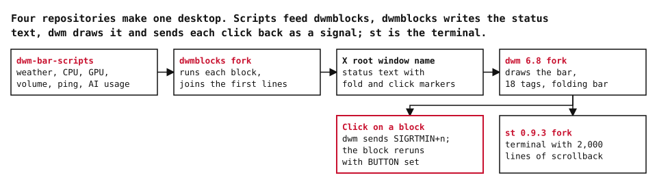

# dwm bar scripts

[Polski](README.pl.md)

Shell scripts used by the local
[dwmblocks configuration](https://github.com/maciejszulia/dwmblocks/blob/master/blocks.h).
They read cached usage/forecast data or query desktop tools. Several controls
also change desktop state; this is a workstation configuration, not a portable installer.



## Scripts and dependencies

| Script | Behaviour | Additional requirements |
|---|---|---|
| `weather` | Reads forecast JSON/JSONL directly, rotates facts, shows change alerts; `--facts`, `--ack` and `--turn` control the display. | `jq`, GNU `date`, forecast files; `pkill` for bar refresh. |
| `ping-artix` | Prints a cached result and starts a background measurement, at most once per configured interval. | `ping`, `awk`; network access to `PING_HOST` (default `artixlinux.org`). |
| `cc-usage` | Reads the last cached Claude limits, marking passed reset times with `?`. | `jq`, GNU `date`, `~/.claude/rate_limits.json`. |
| `codex-usage` | Searches the 20 newest rollout files for the last matching primary-limit entry. | `jq`, GNU `find`/`date`, local Codex logs; supports the recorded payload shape, not every CLI version. |
| `cpu` | Shows CPU temperature, utilisation deltas, frequency and available ThinkPad fan readings. Optional button actions write a fan-control request. | Linux `/proc/stat`, `x86_pkg_temp` thermal sysfs and CPU frequency sysfs; optional `/proc/acpi/ibm/fan`. |
| `gpu` | Prints GPU temperature and utilisation. | NVIDIA driver and `nvidia-smi`. |
| `volume` | Reads volume; clicks change volume or mute through `BUTTON`. | `pactl`, a compatible audio server, GNU `grep -P`. |
| `brightness` | Reads sysfs; wheel events change brightness. | A single matching backlight device; `brightnessctl` and write permission for changes. |
| `brightness-up` / `brightness-down` | Changes brightness and signals `dwmblocks`. | `brightnessctl`, `pkill`. |
| `pogoda` | Forwards arguments to `~/agrocamping-recepcja/scripts/pogoda.mjs`. | Node.js and the separate reception checkout; may fetch weather according to the arguments. |

`weather` defaults to `~/.local/state/agrocamping-recepcja/pogoda.json` and the
adjacent `.jsonl` history. It does not call `pogoda` or fetch forecasts itself.
A separate service must maintain those files; this repository does not install
or prove that service's schedule. `WEATHER_CACHE`, `WEATHER_LOG` and
`WEATHER_FACTS` can point at other files.

## Offline check

`weather --test` uses synthetic forecast files. It also exercises handlers that
call `pkill`, so isolate its process namespace to avoid signalling a running bar.
On Linux with unprivileged user namespaces enabled:

```sh
unshare --user --map-root-user --pid --fork --mount-proc --net \
  env TZ=Europe/Warsaw ./weather --test
```

On 21 September 2026 this returned **26 checks passed**, with no failures.
It validates forecast formatting/rotation/alerts, not hardware or live services.
The explicit timezone is required by the sunrise/sunset fixtures.

`cpu --test` redirects its state to a temporary home but still reads hardware;
it is not a synthetic hardware test. The audit ran its six assertions against
a temporary copy with all hardware paths redirected to fixtures: six passed.

## Installation and scope

Review paths and dependencies, then install only the scripts you need and adjust
`blocks.h` to their locations. Do not replace your entire `~/.local/bin` directory.
The companion CPU block uses signal `0`, so it receives no mouse actions.
If separately wired for clicks, `cpu` uses buttons 1/3 to write
`~/.local/state/wiatrak/manual`; the directory and its consumer must be configured.
The separate `wiatrak` service controls how that request affects cooling and is
not included here. This helper does not verify its thermal-safety policy.
Set `XDG_RUNTIME_DIR` to a writable per-user directory for measurement caches;
otherwise they use `/tmp`. Hardware and external services still require host setup.

The repository uses an allowlist in [.gitignore](.gitignore), originally to track
selected files inside `~/.local/bin`. Add a new script to that allowlist before
staging it, then check `git ls-files`. This prevents accidental additions, but
is not a secret scanner. Do not commit usage logs, cache files or credentials.

## License

MIT. See [LICENSE](LICENSE).
