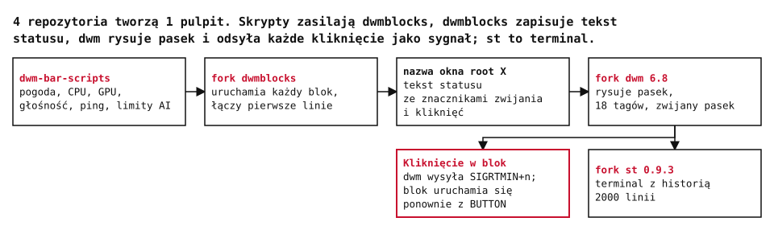

# Skrypty paska dwm

[English](README.md)

Skrypty powłoki używane przez lokalną [konfigurację dwmblocks](https://github.com/maciejszulia/dwmblocks/blob/master/blocks.h). Skrypty czytają dane z pamięci podręcznej (limity użycia, prognozy) albo pytają narzędzia pulpitu. Część skryptów zmienia też stan pulpitu. To konfiguracja stacji roboczej, a nie przenośny instalator.



## Skrypty i zależności

| Skrypt | Działanie | Dodatkowe wymagania |
|---|---|---|
| `weather` | Czyta bezpośrednio prognozę w JSON i JSONL, pokazuje fakty po kolei i alerty o zmianach; `--facts`, `--ack` i `--turn` sterują wyświetlaniem. | `jq`, GNU `date`, pliki prognozy; `pkill` do odświeżenia paska. |
| `ping-artix` | Wypisuje wynik z pamięci podręcznej i uruchamia pomiar w tle co najwyżej raz na ustawiony odstęp. | `ping`, `awk`; dostęp sieciowy do `PING_HOST` (domyślnie `artixlinux.org`). |
| `cc-usage` | Czyta najnowsze zapisane limity Claude i oznacza minione godziny resetu znakiem `?`. | `jq`, GNU `date`, `~/.claude/rate_limits.json`. |
| `codex-usage` | Szuka w 20 najnowszych plikach rollout najnowszego wpisu o limicie głównym. | `jq`, GNU `find` i `date`, lokalne logi Codex; obsługuje tylko zapisany kształt danych, więc inna wersja CLI wymaga sprawdzenia. |
| `cpu` | Pokazuje temperaturę CPU, zmiany wykorzystania, częstotliwość i dostępne odczyty wentylatora ThinkPada. Opcjonalne przyciski zapisują żądanie sterowania wentylatorem. | Linuksowe `/proc/stat`, sysfs termiczny `x86_pkg_temp` i sysfs częstotliwości CPU; opcjonalnie `/proc/acpi/ibm/fan`. |
| `gpu` | Wypisuje temperaturę i wykorzystanie GPU. | Sterownik NVIDIA i `nvidia-smi`. |
| `volume` | Czyta głośność; kliknięcia zmieniają głośność albo wyciszenie przez `BUTTON`. | `pactl`, zgodny serwer dźwięku, GNU `grep -P`. |
| `brightness` | Czyta sysfs; kółko myszy zmienia jasność. | Dokładnie 1 pasujące urządzenie podświetlenia; `brightnessctl` i prawo zapisu dla zmian. |
| `brightness-up`, `brightness-down` | Zmieniają jasność i wysyłają sygnał do `dwmblocks`. | `brightnessctl`, `pkill`. |
| `pogoda` | Przekazuje argumenty do `~/agrocamping-recepcja/scripts/pogoda.mjs`. | Node.js i osobna kopia repozytorium recepcji. Jeżeli argumenty wymagają pobrania, to skrypt pobiera pogodę. |

`weather` domyślnie czyta `~/.local/state/agrocamping-recepcja/pogoda.json` i sąsiednią historię `.jsonl`. Skrypt nie wywołuje `pogoda`. Skrypt sam nie pobiera prognoz. Osobna usługa utrzymuje pliki prognozy. To repozytorium nie zawiera instalatora ani dowodu harmonogramu tej usługi. Zmienne `WEATHER_CACHE`, `WEATHER_LOG` i `WEATHER_FACTS` zmieniają domyślne ścieżki plików.

## Sprawdzenie offline

`weather --test` używa syntetycznych plików prognozy. Test wywołuje też procedury z `pkill`. Uruchom więc test w osobnej przestrzeni nazw procesów, żeby nie wysłać sygnału do działającego paska. Na Linuksie z włączonymi nieuprzywilejowanymi przestrzeniami nazw użytkownika:

```sh
unshare --user --map-root-user --pid --fork --mount-proc --net \
  env TZ=Europe/Warsaw ./weather --test
```

W dniu 2026-09-21 ten test zwrócił **26 udanych sprawdzeń** i 0 błędów. Test sprawdza formatowanie, rotację i alerty prognozy, a nie sprzęt ani działające usługi. Dane testowe wschodu i zachodu słońca wymagają jawnej strefy czasowej.

`cpu --test` przekierowuje stan skryptu do tymczasowego katalogu domowego, ale nadal czyta sprzęt; to nie jest syntetyczny test sprzętu. Audyt uruchomił 6 asercji na kopii tymczasowej, w której każda ścieżka sprzętowa wskazywała dane testowe: 6 asercji przeszło.

## Instalacja i zakres

Przejrzyj ścieżki i zależności. Potem zainstaluj tylko potrzebne skrypty i dopasuj `blocks.h` do położenia zainstalowanych skryptów. Nie zastępuj całego katalogu `~/.local/bin`. Towarzyszący blok CPU ma sygnał `0`, więc nie odbiera kliknięć. Jeżeli podłączysz kliknięcia osobno, to `cpu` zapisuje przyciskami 1 i 3 plik `~/.local/state/wiatrak/manual`. Katalog i odbiorca tego pliku wymagają osobnej konfiguracji. Osobna usługa `wiatrak` decyduje, jak to żądanie wpływa na chłodzenie, i nie należy do tego repozytorium. Skrypt `cpu` nie sprawdza zasad bezpieczeństwa termicznego usługi `wiatrak`. Ustaw `XDG_RUNTIME_DIR` na zapisywalny katalog użytkownika dla pamięci podręcznej pomiarów; bez tej zmiennej skrypty używają `/tmp`. Sprzęt i zewnętrzne usługi nadal wymagają przygotowania hosta.

Repozytorium używa listy dozwolonych plików w [.gitignore](.gitignore); pierwotnie lista śledziła wybrane pliki w `~/.local/bin`. Dopisz nowy skrypt do tej listy przed dodaniem skryptu do indeksu, potem sprawdź `git ls-files`. Lista chroni przed przypadkowym dodaniem plików, ale nie skanuje sekretów. Nie commituj logów użycia, plików pamięci podręcznej ani danych logowania.

## Licencja

MIT. Patrz [LICENSE](LICENSE).
