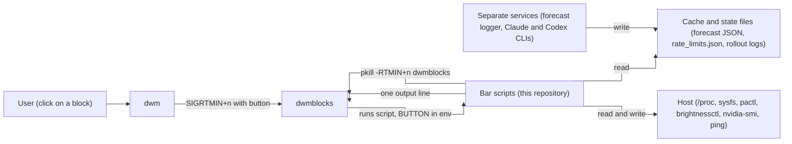
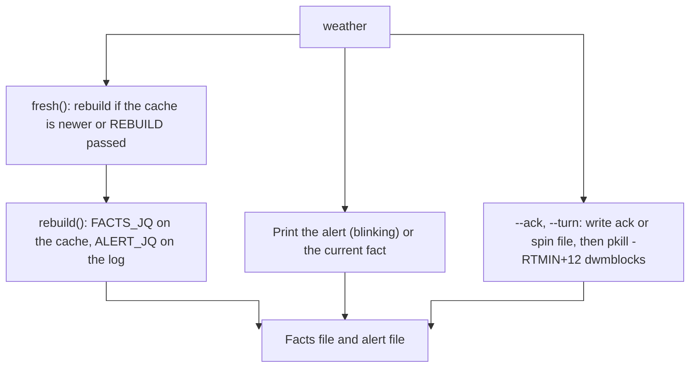
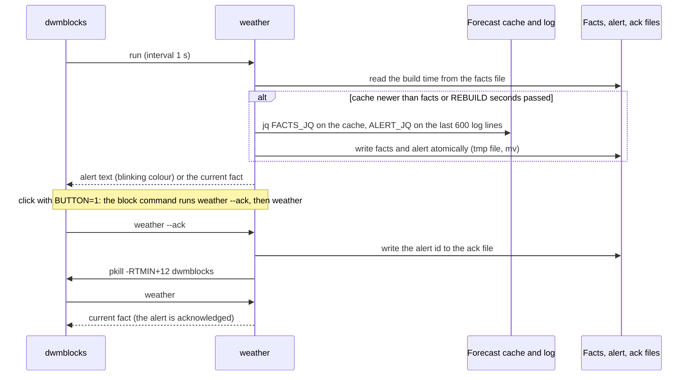

# dwm bar scripts: architecture

This document describes the architecture of the status-bar scripts in the
arc42 layout. Each script is a POSIX `sh` program that prints one line for one
block of [dwmblocks](https://github.com/maciejszulia/dwmblocks).

## 1 Introduction and goals

The repository holds 11 executable scripts: `brightness`, `brightness-down`,
`brightness-up`, `cc-usage`, `codex-usage`, `cpu`, `gpu`, `ping-artix`,
`pogoda`, `volume` and `weather`. dwmblocks runs them on a timer or on a
click and shows their first output line on the dwm bar. Some scripts also
change desktop state (volume, brightness, a fan-control request).

Quality goals, in priority order:

1. A block returns fast, because dwmblocks runs all blocks one after another
   in one thread.
2. A block never reaches the network or another slow source inside its tick;
   slow work runs in the background or in a separate service.
3. Only the listed scripts can be committed; nothing else from the install
   directory can enter git.

## 2 Constraints

| Constraint | Evidence |
|---|---|
| POSIX `sh` scripts (`#!/bin/sh`). | First line of each script |
| Output: one line; bytes `\001` to `\005` select dwm colour schemes. | `cc-usage`, `ping-artix`, `weather` |
| Click input arrives in the environment variable `BUTTON`. | `volume`, `brightness`, `cpu` |
| Host tools: `jq`, GNU `date`, `pactl`, `brightnessctl`, `nvidia-smi`, `ping`, `pkill`, Linux `/proc` and sysfs. | [README.md](../../README.md) |
| The repository lives in `~/.local/bin`, so the tracked files are the files the bar runs. | Commit `2a743c2`, [.gitignore](../../.gitignore) |

## 3 Context and scope

In scope: the scripts and their file formats on the reading side.
Out of scope: the services that write the forecast cache and the usage logs,
the `wiatrak` fan service, and the Node.js program that `pogoda` starts
([README.md](../../README.md)).

## 4 Solution strategy

- One script per block; the script name is the block command in
  `blocks.h` of dwmblocks.
- Cheap tick, expensive work out of band: `ping-artix` prints a cached line
  and starts the measurement in the background
  ([ADR 0002](adr/0002-cached-output-background-measurement.md)).
- `weather` reads a local forecast cache and computes sun times in `jq`;
  it does not fetch data ([ADR 0003](adr/0003-weather-reads-local-cache-only.md)).
- An allowlist `.gitignore` names every tracked file
  ([ADR 0001](adr/0001-allowlist-gitignore.md)).
- Scripts with logic carry their own `--test` mode; CI runs the `weather`
  test ([ADR 0004](adr/0004-self-tests-inside-scripts.md)).

## 5 Building block view

| Script | Responsibility |
|---|---|
| `weather` | Builds a facts file from the forecast cache, rotates one fact per `DWELL` seconds, shows an alert after a forecast change; options `--ack`, `--turn`, `--facts`, `--test`. |
| `ping-artix` | Prints the cached ping line; starts a background `ping -c10` at most once per `PING_EVERY` seconds. |
| `cc-usage` | Reads `~/.claude/rate_limits.json` and prints the left part of the 5-hour and 7-day limits with reset times. |
| `codex-usage` | Searches the 20 newest Codex rollout files for the last `rate_limits` entry. |
| `cpu` | Prints CPU temperature, utilisation, frequency and ThinkPad fan state; buttons 1 and 3 write a fan-level request; `--test` mode. |
| `gpu` | Prints GPU temperature and utilisation from `nvidia-smi`. |
| `volume` | Changes and prints the default sink volume through `pactl`. |
| `brightness` | Prints backlight level; wheel buttons change it through `brightnessctl`. |
| `brightness-up`, `brightness-down` | Change brightness and signal the BRI block (`pkill -RTMIN+11 dwmblocks`). |
| `pogoda` | Starts a Node.js weather program from a separate checkout. |

## 6 Runtime view

### Weather block: tick and click

### Ping block

`ping-artix` prints the cached line at once. When `PING_EVERY` seconds (12 by
default) have passed since the last start, it writes the start time and runs
`ping -c10 -W2` in a background subshell. The subshell writes to a temporary
file and moves it over the cache.

## 7 Deployment view

The repository is a git checkout of `~/.local/bin` (commit `2a743c2`).
dwmblocks calls the scripts by absolute paths from its `blocks.h`. Measurement
caches go to `XDG_RUNTIME_DIR` (`cpu`) or `~/.cache` (`ping-artix`, `weather`).
GitHub Actions runs `TZ=Europe/Warsaw ./weather --test` on `ubuntu-latest` for
pushes to `main` and for pull requests
([ci.yml](../../.github/workflows/ci.yml)).

## 8 Crosscutting concepts

- **Atomic writes.** Scripts write a temporary file and rename it with `mv`
  (`weather`, `ping-artix`, `cpu`), so a reader never sees a half-written file.
- **Environment overrides.** `weather` reads `WEATHER_*` variables,
  `ping-artix` reads `PING_CACHE`, `PING_HOST` and `PING_EVERY`; tests use
  these to redirect files.
- **Refresh by signal.** A script that changes what another block shows
  sends `pkill -RTMIN+n dwmblocks` (`weather`, `brightness-up`,
  `brightness-down`).
- **Stale data marker.** `cc-usage` and `codex-usage` append `?` when the
  stored reset time has passed.

## 9 Architecture decisions

- [ADR 0001: Allowlist .gitignore](adr/0001-allowlist-gitignore.md)
- [ADR 0002: Cached output, background measurement](adr/0002-cached-output-background-measurement.md)
- [ADR 0003: weather reads a local cache only](adr/0003-weather-reads-local-cache-only.md)
- [ADR 0004: Self-tests inside the scripts](adr/0004-self-tests-inside-scripts.md)

## 10 Quality requirements

| Quality | Scenario | Check |
|---|---|---|
| Responsiveness | The ping block returns without waiting for `ping`. | Design of `ping-artix`; no automated test. |
| Forecast logic | Formatting, rotation, alerts, sun times and scroll behave as specified on synthetic data. | `weather --test` in CI ([ci.yml](../../.github/workflows/ci.yml)). |
| Fan request logic | Button 1 steps the level up, button 3 steps it down, the wheel changes nothing. | `cpu --test`; it still reads hardware ([README.md](../../README.md)). |
| Repository hygiene | A file not named in `.gitignore` cannot be staged by accident. | [.gitignore](../../.gitignore) |

## 11 Risks and technical debt

- Most scripts have no test: `cc-usage`, `codex-usage`, `gpu`, `volume`,
  `brightness*`, `ping-artix`, `pogoda`.
- `weather --test` calls `pkill`; on a desktop it can signal the running
  bar unless it runs in an isolated namespace ([README.md](../../README.md)).
- `codex-usage` supports one recorded payload shape, not every CLI version
  ([README.md](../../README.md)).
- `pogoda` depends on a separate checkout at a fixed home-directory path.
- The `cpu` fan request has no consumer in this repository; the separate
  `wiatrak` service defines its thermal-safety policy ([README.md](../../README.md)).
- A new script that is missing from the allowlist is skipped by `git add`
  without a message (commit `9082671`).

### Open questions

- None.

## 12 Glossary

| Term | Meaning |
|---|---|
| Block | One segment of the dwm status text, produced by one script. |
| `BUTTON` | Environment variable with the mouse button number of a click. |
| Fact | One line of the weather rotation, for example the next rain or the next sunset. |
| Alert | A sudden forecast change (rain, gust, temperature); it blinks until acknowledged. |
| Allowlist | A `.gitignore` that ignores `*` and then names the tracked files with `!`. |
